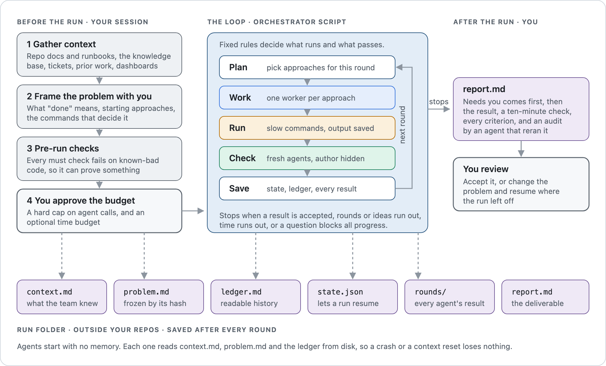
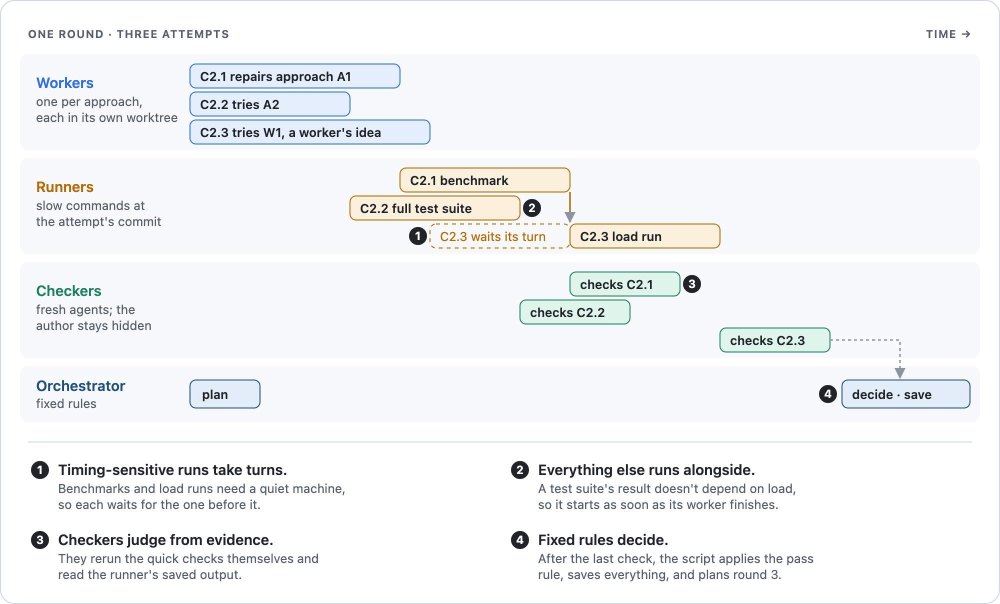
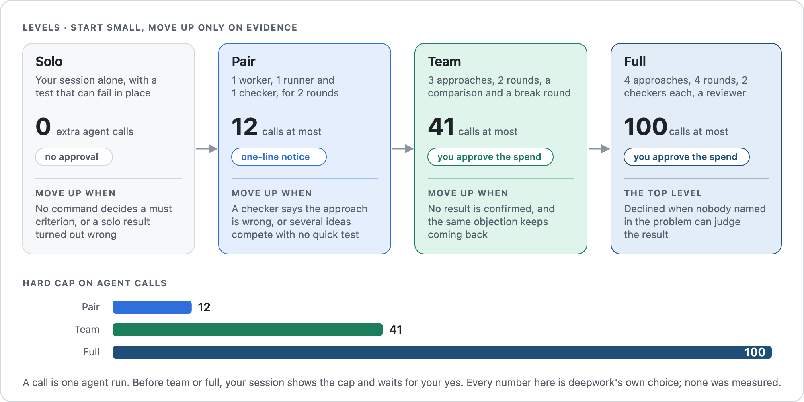

# deepwork

deepwork is an agent skill for hard software problems. It runs several AI agents on separate attempts at the same problem, has fresh agents check each attempt against criteria you agree on up front, and hands you a short report you can verify in about ten minutes.

It works in [Claude Code](https://code.claude.com) and in OpenAI's [Codex CLI](https://developers.openai.com/codex).

## Why deepwork exists

When you give a coding agent a hard problem, its first answer is often confident and wrong. Asking the same agent to check itself rarely helps, because it reviews its own work with the same blind spots it had when it wrote it.

deepwork borrows the habits of a careful engineering team:

- **Agree on what "done" means before anyone starts.** You and the agent write the acceptance criteria first, and nobody changes them mid-run.
- **Try more than one idea.** Separate agents work on separate approaches, each in its own copy of the repository.
- **Check with fresh eyes.** A different agent reviews each attempt without knowing who wrote it.
- **Let fixed rules decide.** A script decides whether an attempt passed and what to try next, using rules the repo's tests cover.
- **Keep a written record.** Every round is saved to disk, so a crash or a reset loses nothing and every claim in the report points to evidence.

The result is slower and more expensive than asking one agent. Use it when being wrong costs more than the extra time.

## When to use it

deepwork handles three kinds of work, called modes:

| Mode | You bring | You get |
|---|---|---|
| Research | A question, such as "what does each extra iframe cost the page?" | An answer with checked sources and measurements |
| Investigation | A symptom, such as a rare test failure | The root cause, with the other suspects ruled out |
| Implementation | A change to make | A change that meets the criteria, checked by agents that didn't write it |

It's a good fit when:

- A first attempt already failed.
- Several explanations compete and no quick test tells them apart.
- A failure is rare or hard to reproduce.
- The tests are weak exactly where the risk is.
- You want an independent check before you accept a result.

It's a poor fit for routine changes that one agent and a failing test can handle. For those, the skill picks its smallest level, solo, and your session does the work with the failing test in place.

## How it works

You work with your normal agent session. That session prepares the run with you, and then hands the loop to an orchestrator script that launches the other agents.

<picture>
  <source media="(prefers-color-scheme: dark)" srcset="docs/images/overview-dark.png">
  
</picture>

The orchestrator script makes every pass or fail decision from the checkers' results. Your session relays those decisions and talks to you.

### One round

Each round sends every planned attempt through the same steps. The work moves through a pipeline, so one attempt can be in checking while another is still running its slow commands.

<picture>
  <source media="(prefers-color-scheme: dark)" srcset="docs/images/round-dark.png">
  
</picture>

- A **worker** attempts one approach and commits its result.
- A **runner** runs the slow commands for that attempt, such as benchmarks or the full test suite. Runners whose results depend on a quiet machine take turns; the rest run side by side.
- A **checker** reruns the quick checks and judges the attempt against every criterion. It sees an attempt ID such as `C2.1` and nothing about who wrote it.

At higher levels, a comparison checker also reads the round's attempts side by side, and a "break round" sends an agent to find a case where a passing attempt fails. An attempt that survives the break round is confirmed.

### Levels

A run starts as small as the problem allows and grows only when the evidence says it needs to. Each level has a hard cap on agent calls.

<picture>
  <source media="(prefers-color-scheme: dark)" srcset="docs/images/levels-dark.png">
  
</picture>

Before team or full, your session shows you a spend confirmation with the call cap and waits for your yes. You can also set a time budget, and the run stops before starting a round that wouldn't finish in time.

## What a run produces

Everything lives in one run folder outside your repositories. You'll read the report first and the ledger when you want the history.

| File | What it holds |
|---|---|
| `context.md` | What the team already knew, gathered before framing |
| `problem.md` | The question, criteria and starting approaches, frozen by its hash |
| `ledger.md` | A readable history of every attempt, objection and decision |
| `state.json` | The official state, so a stopped run can resume |
| `rounds/` | Every agent's result, round by round |
| `report.md` | The deliverable |

The report opens with **Needs you**: the questions, proposals and decisions that only you can settle. It then gives the result, at most five commands to check it yourself, a row per criterion, the alternatives that were ruled out, and what nobody checked. A final audit section comes from an agent that reran those commands.

## Get started

### Install

Clone the repository and link it where your agent looks for skills.

```bash
git clone https://github.com/hcastro/deepwork.git ~/Projects/deepwork

# Claude Code
ln -s ~/Projects/deepwork ~/.claude/skills/deepwork

# Codex
ln -s ~/Projects/deepwork ~/.agents/skills/deepwork
```

You need Node.js 18 or later and git. The host script for Codex uses only Node's standard library.

### Run it

1. In your agent session, describe the problem and ask for deepwork. In Claude Code you can also type `/deepwork`; in Codex, `$deepwork`.
2. Work with the session as it gathers context and writes `problem.md`. Expect questions about what "done" means.
3. Review the spend confirmation and approve it.
4. Read the report, starting with **Needs you**, and run its ten-minute check.

The session follows [`references/run.md`](references/run.md) for every step. [`references/runtimes.md`](references/runtimes.md) has the details for each runtime.

## Key ideas

- **Acceptance criteria.** Each criterion is a must, should or stretch. Only must criteria block acceptance. When a command can decide a criterion, the criterion names that command.
- **Fail-first check.** Before a run starts, every must criterion's command has to fail on a known-bad version of the code. A check that can't fail can't prove anything.
- **Frozen problem.** `problem.md` is locked by its hash. Changing it means a new confirmation.
- **Blind checking.** Checkers never see who wrote an attempt, and never grade their own work.
- **Failures count.** A crashed, skipped or invalid check counts as a failure.
- **Context first.** Agents start with no memory, so the session writes down what the team already knows before the run starts, and agents look there before asking you anything.

## Limits

- Every checker shares the worker's model family and can share its blind spots. A human review is always required.
- The call caps are deepwork's choices. Nobody has measured the ideal numbers.
- The loop has completed one real run so far, and that run exposed the problems listed in [`evals/README.md`](evals/README.md). They're fixed in the code and covered by offline tests. A graded rerun on the same problem is next, to show the fixes improve the result.

## Repository layout

| Path | What it holds |
|---|---|
| `SKILL.md` | The skill as an agent loads it: rules, levels and steps |
| `references/` | The runbook, the standard checkers apply, and per-runtime notes |
| `assets/` | Templates for the context pack, the problem and the spend confirmation |
| `workflows/deepwork.js` | The orchestrator: the planner, the acceptance rule and every prompt |
| `scripts/deepwork-host.mjs` | Runs the orchestrator under Codex, and drives pair runs by hand |
| `evals/` | Offline tests, a fake `codex` for dry runs, and the history of what changed and why |

## Test it

The tests make no model calls.

```bash
node scripts/deepwork-host.mjs selftest         # schemas, planner and acceptance rules, pair by hand
node scripts/deepwork-host.mjs selftest --dry   # adds full runs against a fake codex
```

## Background

The loop adapts the multi-agent method from the Cogentic paper on hard research problems. It cuts the parts that cost calls without a measured benefit, and replaces model judgment with fixed rules wherever a rule can decide. [`references/run.md`](references/run.md) lists what was cut and why.
